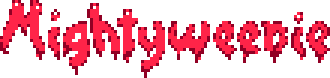

<p align="center"></p>

# mightyweenie

A from-scratch reimplementation of **Mutant League Hockey** (Sega Genesis,
Electronic Arts / Abalone, 1994) in Godot 4.7.1, built by reverse engineering the
original in Ghidra using Opus 5.5

This is a spite project I did partially to prove a point. In total, it took about
three days to go from nothing but Ghidra, BlastEm/GPGX and the ROM to the state of
this project as initially published to Github.

Mightyweenie isn't a recompilation, but built with GDScript that matches the original
game's behaviour. Audio is handled through emulating FM synth using ymfm, PCM playback
and mixing is handled natively by Godot.

# New Features

* `3D rink view` - switchable at any moment during play, with exactly the same gameplay as
2D. The rink is a 3D model textured live from the supplied ROM. Alternate views are
available via F row keys, though they can cause some visual issues for the moment.
* `3D nets` - The standard net and the Battle Net pull colour data and some texture
information from the ROM too.
* `3D crowd` - Fans are cut from the ROM's crowd art and seated on 3D stands. Missing front
and back views, as well as mising pixel information, were drawn by hand and are merged on
top of the ROM's graphical assets.
* `Unlocked frame rate` - The 3D view renders at any frame rate and blends smoothly between
simulation steps. The game logic still runs at the original's rate.
* `True translucency` - In place of the Genesis shadow and highlight effects.
* `Keyboard and gamepad support` - Accessible using the new Options menu.
* `Online multiplayer` - up to 12 players on as many machines, every machine running the
same game from the same inputs; encrypted, with a password if you like (see "Playing
online" below).

# New in v0.2

* `Local play for up to 12` - every player on a controller of their own, with character
selection, captains and line-ups before a match; playoff runs can be saved and loaded.
* `EXTENDED play` - 2D EXTENDED and 3D EXTENDED cameras zoom to keep every player's
character and the puck in the picture, with optional EXTENDED PENALTIES and EXTENDED CPU.
* `CREATE-A-TEAM` - teams of your own: city, name, logo and colours, and a coach with his
own face and speeches.
* `Replays` - FULL GAME instant replays rewind over the whole match; matches and the attract
demos can be saved and watched again from REPLAYS.
* `Arena paint` - blood and oil stay on the 3D ice, boards and glass all match, with
detailed ice and reflections (VISUALS); REPLAY BLOOD shows the paint in replays too.
* `A livelier arena` - the crowd sways and cheers with the game, 3D benches, the match's
opening in 3D, and a pool of new organ tunes.
* `TICK RATE` - the original's own pace, slowdowns included, or a steady one.
* `Widescreen` - with ASPECT RATIO WIDE the rink fills a wide display, in 2D and 3D.

No ROM data shipped. All art, maps and data are read from your own ROM at runtime. Exported
builds look for it next to the executable (or the AppImage), in the user data folder or at a
--rom= path; when it is in none of those, a file dialog asks for it and the game keeps a copy
in the user data folder.

For developers: you can browse the ROM's graphics in the Godot editor, and the simulation
is checked step by step against recordings of the original.

Targets Linux and Windows. Further ports are welcome.

Bring your own ROM (see `rom/README.md`).

## Playing online

START GAME, then ONLINE MULTIPLAYER. One player hosts, the others join; everyone needs the
same build of the game and the same ROM (the game checks both).

* **Hosting:** HOST GAME, choose a PORT (42032 unless you change it) and a PASSWORD (or none),
  START SERVER. The lobby lists your addresses to share; COPY ADDRESS puts one on the
  clipboard. Local players join with any button on their controller and leave with Back.
  START GAME when everyone is in.
* **Joining:** JOIN GAME, type or paste the host's address (`192.168.1.20`, `example.org`,
  `203.0.113.5:42032`, `[2001:db8::5]:42032`; the port is 42032 unless the host says
  otherwise) and the password, CONNECT TO SERVER. Passwords ignore case.
* **The port (UDP):** the host's machine must be reachable on its port over UDP. On a home
  network that means the router forwards UDP port 42032 to the hosting computer. The game
  asks the router to do it by itself (UPnP): the lobby says PORT OPEN when that worked and
  OPEN PORT 42032 ON YOUR ROUTER when it didn't - then add the forwarding in the router's
  settings (UDP, the port, the hosting computer's local address). Players on the same
  local network can join with the host's local address and need no forwarding.
* **Firewalls:** allow the game to receive on its UDP port on the hosting computer
  (Windows asks the first time you start a server: allow it). Joining needs nothing.
* **IPv6:** the host listens on IPv4 and IPv6 at once. Over IPv6 there is usually nothing to
  forward, but the router's or the computer's firewall may still have to let UDP 42032 in.
* **Passwords and encryption:** every connection is encrypted. The password itself never
  crosses the network, and with a password nobody in between can pretend to be the host.
* **"THIS HOST'S KEY HAS CHANGED":** the game remembers each host's key the first time
  you join it. If it changes, the game asks before going on. That is expected when the host
  plays on another computer or has reinstalled the game (or deleted its saved data); if not,
  someone may be in the middle - ask the host, and use a password.
* **Dropping out:** if your connection or the game drops, ONLINE MULTIPLAYER offers REJOIN
  while the match goes on: you get your players back from the next face off. The CPU plays
  for you meanwhile, and for any player who lags or leaves.
* **The host's upload speed:** hosting takes about 80 kbit/s of upload for each machine
  that joins, so about 1 Mbit/s for a full lobby of 11. On a slower line the host sends
  half as often by itself: a full lobby still plays on about 0.7 Mbit/s and gets laggy
  below that.
* A slow or lossy connection makes your game wait now and then; very bad ones (a fifth of
  the traffic lost) can drop you, and REJOIN brings you back.


## Building

```bash
tools/setup/fetch_tools.sh && tools/setup/setup_python.sh
tools/bin/setup-rom         # your ROM into the Godot project (game/rom/mlh.gen)
tools/bin/build-audio       # the audio extension (needs g++ and make)
tools/bin/godot-test        # Godot unit tests (GUT, headless)
tools/bin/harness-test      # reference-emulator tests (pytest)
tools/bin/godot-editor      # open the editor (desktop)
tools/bin/compare compare/scripts/coop_start.mwi   # original vs ours, first difference
tools/bin/export-linux      # packages in out/builds/ (also tools/bin/export-windows)
```

## Licences

The project's code is under the BSD 3-Clause License ([`LICENSE`](LICENSE)). It covers
this project's own code only; the game's data is not included. Vendored: GUT (MIT). The
audio extension's third-party code (ymfm, godot-cpp) is listed in
`game/addons/mw_audio/THIRD_PARTY_NOTICES.txt`. The input glyphs are "Virtual key codes
tileset" by YellowAfterlife (CC0) and "Pixel Button Prompt" by FrankTheApe (free for
commercial use); see `game/assets/glyphs/CREDITS.md`. Tools fetched at setup keep their own
licences; emulators are used for observation only and are not linked into the game.

Mutant League Hockey is a trademark of its owners. This is an unofficial fan project, not
affiliated with or endorsed by Electronic Arts or Sega.
